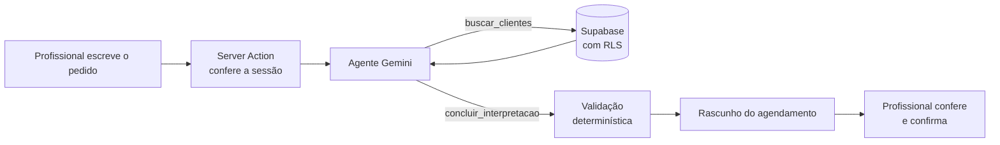

# Nail Agenda

 
 


Agenda privada, feita para o celular, para um salão de unhas com duas profissionais. Cada uma atende
as suas clientes, e as duas enxergam a agenda completa do salão. Sem agendamento público: as
profissionais marcam tudo, dentro de uma área com login. **Em uso real, publicada na Vercel.**

**Funciona assim:** cadastro de clientes (compartilhado), serviços e preços de cada profissional, agenda do dia
com aviso de horário sobreposto, confirmação pelo WhatsApp com mensagem pronta, status do atendimento
(confirmar, concluir, não compareceu, cancelar, reabrir) e tela inicial com o resumo do dia.
Instalável no celular (PWA).

### Destaques técnicos
- **Agente de IA com tool calling**: agendamento a partir de uma frase ("Ana sexta 14h pé e mão"), com validação
  determinística da resposta do modelo (detalhes abaixo).
- **Segurança em camadas**: RLS no Postgres, autorização revalidada em toda Server Action, chaves só no servidor.
- **Regras de negócio testáveis**: lógica separada do Next.js, com 415 testes unitários e de componentes,
  testes de integração contra o Supabase real, testes de banco/RLS e testes E2E em telas de celular (Playwright).
- **Robustez**: idempotência no agendamento (toque repetido não duplica), aviso de conflito de horário,
  fuso America/Sao_Paulo tratado explicitamente, backup e restauração.

## Agendamento por texto com IA
A profissional escreve o atendimento como falaria — **"Ana sexta 14h pé e mão"** — e um agente de IA
identifica cliente, serviço, data e horário. O agendamento **não é gravado pela IA**: a sugestão preenche o
fluxo de agendamento e a profissional confere e confirma no resumo, com o mesmo botão "Agendar" de sempre
(com aviso de horário ocupado e proteção contra envio duplicado).

**Como funciona**
1. A tela (`/agendamentos/novo/texto`) envia o texto a uma Server Action, que confere a sessão.
2. Um agente (AI SDK + Google Gemini) recebe as instruções, o calendário dos próximos 15 dias e os serviços
   ativos da profissional, e usa a ferramenta **`buscar_clientes`** (tool calling) para achar a cliente no banco,
   com a sessão da usuária (a RLS vale também para a IA).
3. O agente entrega o resultado chamando a ferramenta `concluir_interpretacao`, com entrada validada por schema (Zod). Esse resultado passa por uma **conferência determinística**
   (`resolveInterpretation`): a cliente precisa ter vindo da busca, o serviço precisa ser da profissional e
   data/hora precisam ser válidas. Ids inventados pelo modelo são descartados. Datas no passado geram aviso.
4. Ambiguidade (duas "Ana") vira opções para a profissional escolher; o que faltar é escolhido nas etapas normais.



**Privacidade e segurança**: ao modelo vão só id e nome das clientes (o telefone não sai do servidor); o
pedido é tratado como dado, não como instrução (proteção contra prompt injection); a chave fica só no servidor e
o código de IA não vai para o navegador; sem chave configurada, o recurso fica escondido.

**Arquitetura**: `src/lib/ai/model.ts` é o único lugar que conhece o provedor (trocar de Gemini para Claude,
OpenAI ou Groq é mudar só esse arquivo); `src/lib/ai/booking.ts` tem o agente, sem depender do Next nem do
Supabase, e é testado com um modelo simulado (`MockLanguageModelV4`), sem chamar a API.

**Para ativar**: crie uma chave gratuita no [Google AI Studio](https://aistudio.google.com/apikey) e coloque em
`GOOGLE_GENERATIVE_AI_API_KEY` no `.env.local` (e, se quiser na Vercel, como variável de servidor, sem
`NEXT_PUBLIC_`). No plano gratuito o Google pode usar o conteúdo enviado para melhorar os produtos dele: use-o
com dados de demonstração e o plano pago com dados reais.

## Tecnologias
Next.js 16 (App Router) · React 19 · TypeScript · Tailwind CSS 4 · shadcn/ui · Supabase (Postgres, Auth e RLS) ·
React Hook Form + Zod · Vitest + Testing Library · Playwright · AI SDK + Google Gemini (tool calling) · hospedagem na Vercel.

## Instalação e execução local
Precisa de Node 22 ou superior.

```bash
npm install
cp .env.local.example .env.local   # preencha com as chaves do seu projeto Supabase
npm run dev                        # http://localhost:3000
```

1. **Configure o Supabase** (projeto, chaves, tabelas e segurança): siga o [docs/SUPABASE.md](docs/SUPABASE.md).
2. **Cadastre as duas profissionais**: preencha as variáveis `SEED_*` do `.env.local` (nome, e-mail e senha de cada uma,
   com senha de pelo menos 8 caracteres) e rode `npm run seed`. O comando é seguro para repetir. Depois, cada
   profissional pode trocar nome, senha e e-mail em **Menu → Perfil**.
3. Abra o app e entre com uma das contas.

> O cadastro público de usuários deve ficar **desligado** no Supabase (Authentication). As contas só são criadas pelo `seed`.

## Publicação (Vercel)
Veja o [docs/DEPLOY.md](docs/DEPLOY.md). Na Vercel entram só as duas variáveis públicas do Supabase;
a chave secreta nunca vai para lá.

## Comandos
| Comando | O que faz |
|---|---|
| `npm run dev` | Servidor de desenvolvimento. |
| `npm run build` / `npm start` | Compila e executa a versão de produção. |
| `npm run lint` e `npx tsc --noEmit` | Verificações de código e de tipos. |
| `npm test` | Testes de unidade e de componentes (Vitest). Não usam o banco. |
| `npm run test:db` | Esquema e regras de segurança num Postgres em memória. |
| `npm run test:integration` | Regras do app contra o **Supabase real** (usa as contas do seed; apaga o que cria). |
| `npm run test:supabase` | Verificação de segurança contra o Supabase real. |
| `npm run test:e2e` | Testes de ponta a ponta em tela de celular (Playwright + Edge instalado). Compila o app, usa o Supabase real e apaga o que cria. |
| `npm run seed` | Cria o salão e as duas profissionais. |
| `npm run backup` | Cópia de segurança dos dados em `backups/` (ver abaixo). |
| `npm run restore -- --from backups/<pasta>` | Restaura o que faltar a partir de um backup (simula; use `--confirm` para gravar). |
| `npm run icons` | Gera de novo os ícones do app. |

Os testes que usam o Supabase real precisam do `.env.local` preenchido, incluindo `SUPABASE_SECRET_KEY` e as contas `SEED_*`.

## Cópia de segurança
```bash
npm run backup
```
Grava todas as tabelas em `backups/AAAA-MM-DD_HH-MM-SS/` (arquivos JSON) e confere as contagens. A pasta `backups/` está
no `.gitignore` porque contém dados pessoais das clientes: guarde-a em local seguro e **nunca** no repositório.
Faça um backup com regularidade (por exemplo, toda semana). Para recuperar dados apagados:
`npm run restore -- --from backups/<pasta>` mostra o que falta; com `--confirm`, grava. A restauração só **insere** o
que não existe e nunca altera nem apaga nada.

## Instalar no celular
Em **Menu → Configurações** há o passo a passo para Android (Chrome) e iPhone (Safari).

## Estrutura
```
src/app/            telas e rotas (login, início, agenda, clientes, serviços, perfil...)
src/components/     componentes (agenda, formulários, navegação, shadcn/ui)
src/lib/            regras de negócio e utilitários (fuso, telefone, status, mensagem do WhatsApp...)
src/lib/ai/         agendamento por texto: escolha do modelo e agente de IA
supabase/migrations tabelas, regras de segurança (RLS) e permissões, em SQL versionado
scripts/            seed, backup, restauração e ícones
tests/              testes de integração (Supabase real), de banco (em memória) e E2E (Playwright)
docs/               documentação do projeto, do Supabase e da publicação
```

## Segurança, em resumo
- Tudo fica atrás de login. Sem sessão, qualquer tela privada leva ao login.
- Cada profissional cria e edita só os próprios atendimentos, serviços e horários; a agenda é privada (cada uma vê só os próprios atendimentos); só os clientes e os serviços são compartilhados para consulta.
- As regras de acesso valem também no banco (RLS), não só nas telas.
- A chave secreta do Supabase só é usada em scripts na sua máquina.
- Horários são guardados em UTC e exibidos no fuso de São Paulo.

Documentação do projeto (decisões, etapas e pendências): [docs/PROJETO.md](docs/PROJETO.md).

## Autor
**Diogo Roberto** — desenvolvedor full-stack, estudante de Análise e Desenvolvimento de Sistemas (FIAP).
[LinkedIn](https://www.linkedin.com/in/diogo-roberto-b56899317/) · [GitHub](https://github.com/diogoroberto24)
